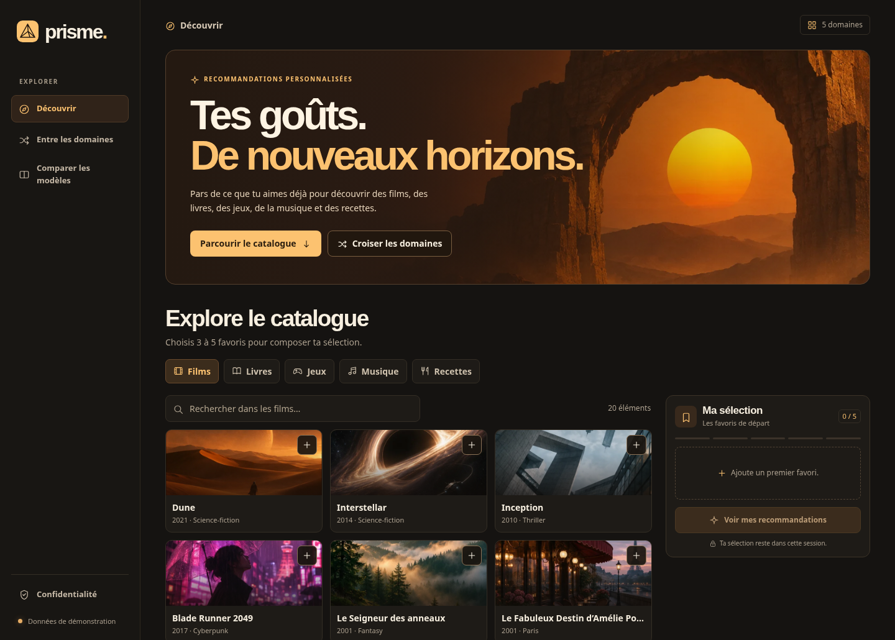
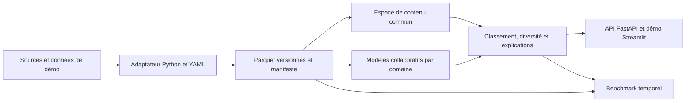

# Prisme

Prisme recommande des films, des livres, des jeux, de la musique et des recettes à partir de quelques favoris. On peut prolonger une découverte dans un autre domaine, par exemple passer de trois films à des livres, et comparer deux modèles sur la même sélection.

[](https://github.com/Joann002/Prisme/actions/workflows/ci.yml)



[Voir le GIF de démonstration](reports/demo.gif)

## Démarrer

Python 3.11 à 3.13 et [uv](https://docs.astral.sh/uv/) sont pris en charge par le projet. La démo démarre sans clé d’API ni données externes.

```bash
make setup
make demo   # http://localhost:8501
```

Dans un autre terminal, lance `make api` pour l’API et son interface sur `http://localhost:8000`. Swagger est disponible sur `http://localhost:8000/docs`. Les deux applications peuvent aussi démarrer via `docker compose up --build`.

```bash
curl http://localhost:8000/domains
curl 'http://localhost:8000/recommend?domain=movies&user_id=demo-015&k=5'
curl http://localhost:8000/cross-recommend \
  -H 'Content-Type: application/json' \
  -d '{"source_domain":"movies","target_domain":"books","liked":["dune","inception","interstellar"]}'
```

| Route | Fonction |
| --- | --- |
| `GET /health`, `GET /domains` | État, domaines, modèles disponibles |
| `GET /catalog/{domain}` | Recherche et pagination |
| `GET /recommend`, `POST /recommend/items` | Recommandations depuis un profil ou des favoris |
| `GET /similar/{item_id}?domain=movies` | Voisins par contenu, avec désambiguïsation des ID |
| `POST /cross-recommend` | Recommandations dans un deuxième domaine |
| `POST /feedback`, `GET /metrics` | Votes agrégés et métriques Prometheus |

## Architecture



- [Fiches de données, formats et licences](docs/datasets.md)
- [Ajouter un domaine avec un adaptateur et un YAML](docs/ajouter-un-domaine.md)
- [Fiches de modèles et limites](docs/modeles.md)
- [Conteneurs, Hugging Face Spaces, release et monitoring](docs/exploitation.md)
- [Confidentialité](docs/confidentialite.md) et [article de lancement](docs/lancement.md)

## Évaluation reproductible

```bash
make all
make tune
make advanced
```

`make all` installe les dépendances depuis `uv.lock`, lance les tests, génère les Parquet, recalcule les rapports et construit la documentation. `make advanced` installe PyTorch CPU, Sentence Transformers et FAISS et recalcule le rapport sémantique. La première exécution récupère le modèle multilingue. On peut aussi passer un chemin de modèle local à `reco-platform benchmark --semantic CHEMIN`. Pour servir ces modèles, renseigne `RECO_SEMANTIC_MODEL`. Les modèles légers restent disponibles sans téléchargement. Pour charger des vecteurs déjà calculés, utilise `reco-platform export-content` puis `RECO_SEMANTIC_INDEX`. Les essais Optuna et les benchmarks peuvent être suivis dans MLflow avec `--tracking-uri sqlite:///prisme-mlflow.db`.

Le protocole temporel réserve la dernière préférence par profil. Les événements à la même date ou postérieurs sont exclus de l’entraînement de ce profil. Optuna utilise une validation temporelle dans le sous-ensemble d’entraînement. Le filtrage par fréquence utilise le sous-ensemble qui sert à ajuster le modèle. Les métadonnées de catalogue sont considérées disponibles et peuvent servir aux nouveaux éléments. Goodbooks-10k peut être utilisé pour le classement à partir d’un import, mais il est exclu du protocole temporel en l’absence de vraies dates.

On rapporte Precision, Recall, NDCG et MAP à K=5. NDCG donne plus de poids aux recommandations bien placées. La couverture mesure la part de catalogue exposée, la diversité utilise la distance de Jaccard entre tags et la nouveauté utilise la rareté dans l’entraînement. Pour le cold start utilisateur, des profils entiers sont exclus de l’entraînement et évalués avec zéro ou trois favoris. Pour le cold start item, un instantané chronologique précède la première interaction des éléments testés. Les relations entre domaines sont évaluées séparément pour les adaptations et pour les thèmes, ou via un fichier de référence externe.

## Résultats de la démo

Ouvre le notebook avec un environnement Jupyter qui dispose de l’extra `analysis` (`uv sync --locked --extra analysis`).

Le catalogue contient **98 éléments**, **150 profils synthétiques** et **5 645 interactions**. Voici le NDCG@5 du scénario avec historique pour le profil léger.

| Modèle | Films | Livres | Jeux | Musique | Recettes |
| --- | ---: | ---: | ---: | ---: | ---: |
| Aléatoire | 0,207 | 0,188 | 0,215 | 0,244 | 0,211 |
| Popularité | 0,313 | 0,326 | 0,292 | 0,380 | 0,347 |
| TF-IDF | 0,358 | 0,345 | 0,355 | 0,375 | 0,246 |
| Voisins item-item | **0,443** | **0,520** | **0,468** | **0,457** | **0,444** |
| SVD | 0,336 | 0,398 | 0,318 | 0,361 | 0,329 |
| ALS | 0,368 | 0,381 | 0,346 | 0,390 | 0,320 |
| Hybride | 0,383 | 0,402 | 0,390 | 0,397 | 0,314 |

- [Tableau complet, cold start, cross-domain et ablations](reports/benchmark.csv)
- [Courbes NDCG par modèle et par domaine](reports/ndcg.svg)
- [Notebook d’analyse exploratoire](notebooks/01_eda.ipynb)
- [Analyse du benchmark et des erreurs](reports/analyse.md)
- [Benchmark de neuf modèles avec Sentence Transformers et FAISS](reports/semantic/benchmark.csv)
- [Benchmark de sept modèles sur MovieLens Latest Small](reports/movielens/benchmark.csv)

Les voisins item-item sont le meilleur choix mesuré pour des profils avec historique sur la simulation. La démo présente l’hybride pour le parcours à favoris explicites. Les catalogues sont petits et les profils synthétiques sont construits par thème. Sur MovieLens Latest Small, ALS atteint le meilleur NDCG@5 avec historique, à 0,037. Le transfert entre catalogues réels reste à mesurer sur des relations de référence indépendantes.

## Publication

Le dépôt contient un workflow GitHub Actions manuel pour publier la démo sur un Space Docker et une configuration de release pour PyPI et GHCR. Le badge CI indique l’état des vérifications sur `main`. [Configuration du Space et du secret Actions](docs/exploitation.md)

Le code est sous [licence MIT](LICENSE). Les deux polices embarquées sont sous SIL Open Font License. Les sources tierces conservent leurs propres conditions. Voir [Contribuer](CONTRIBUTING.md).
